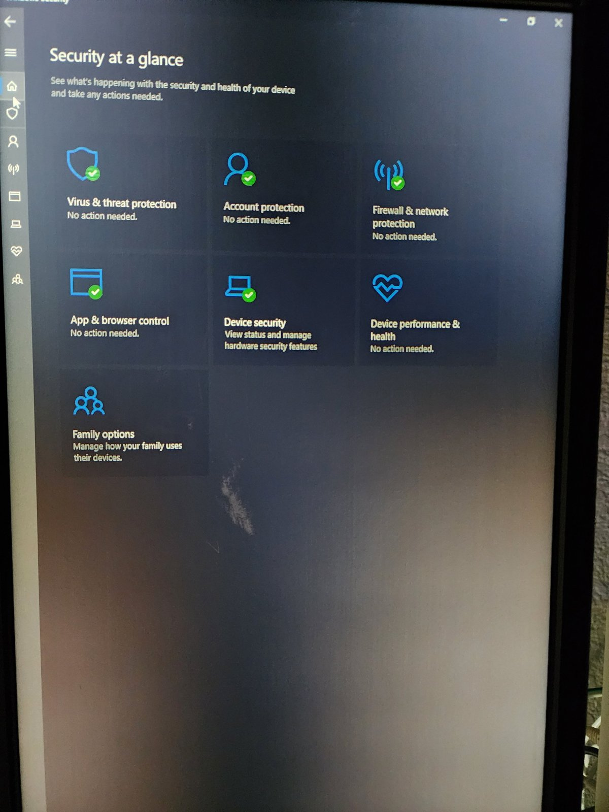
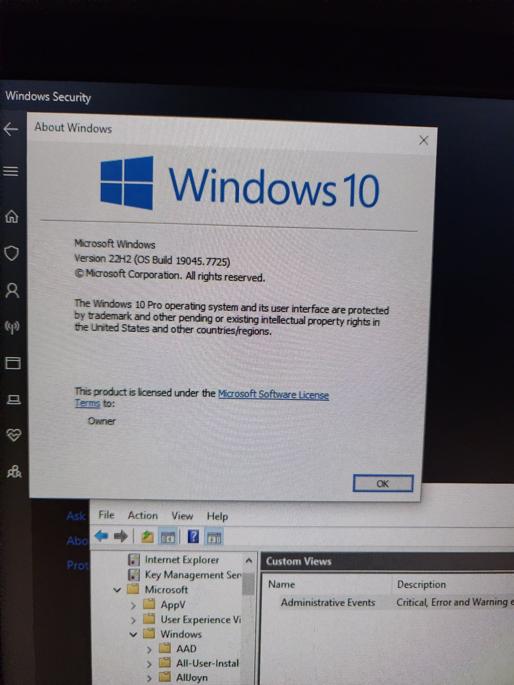
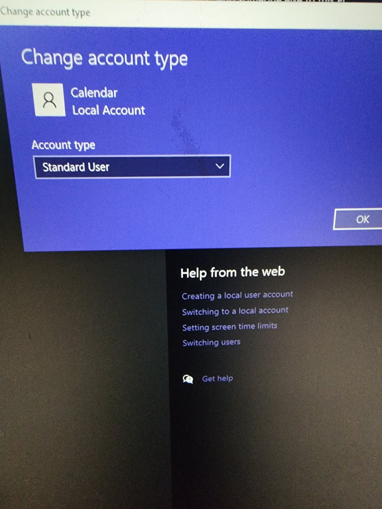
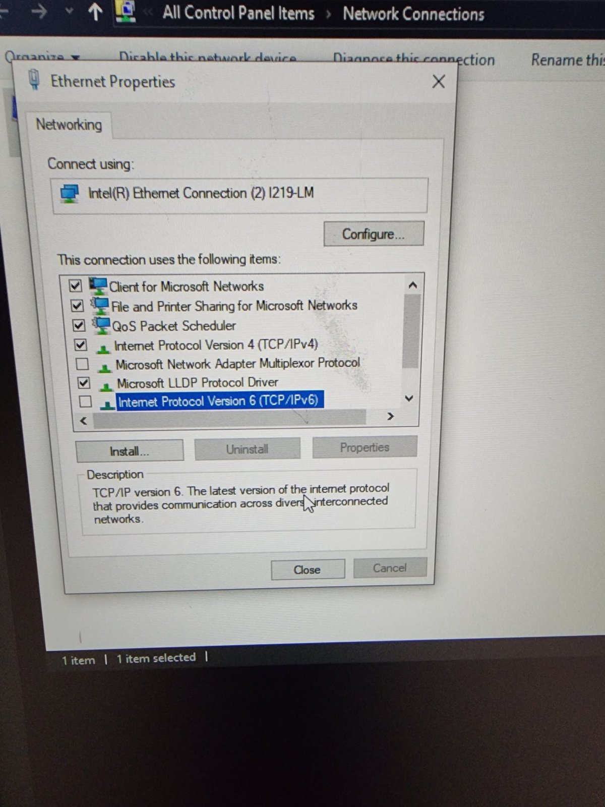
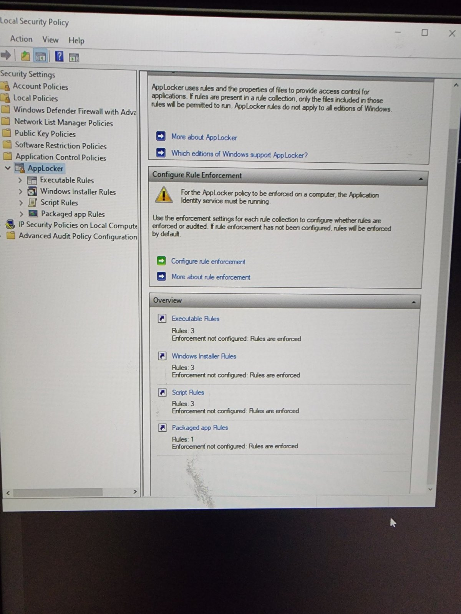
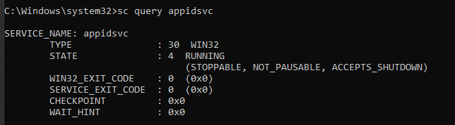
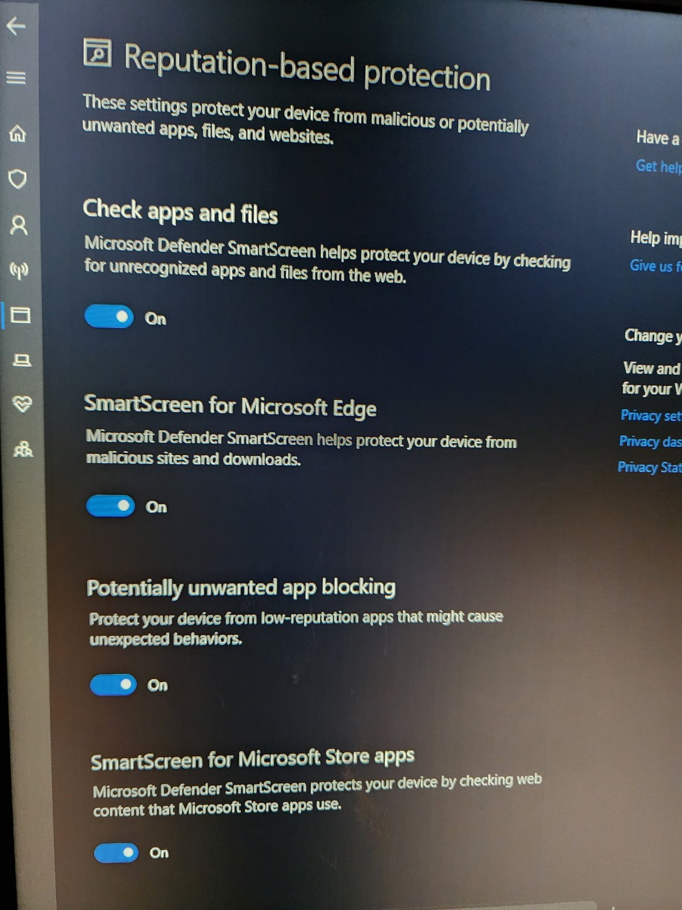

# 🛡️ Windows 10 Never Dies
### Lock down your Windows 10 PC — even after End of Life

> Microsoft ended mainstream support for Windows 10 on **October 14, 2025**.
> Millions of perfectly good PCs are still running it — in homes, with kids, online every day.
> This guide is a tested, step-by-step playbook to make one of them as safe as it can be:
> **antivirus, family-safe DNS, image filtering, app whitelisting, and a kid-proof account** — using only what's already built into Windows.

Every step below was performed and verified on a real machine (**Windows 10 Pro 22H2, build 19045.7725**), with screenshots. Each step ends with a **✅ Do** and **❌ Don't**.

---

## ⚠️ Read this first

- **No guide can replace security updates.** Enroll in Microsoft's **Extended Security Updates (ESU)** if you can, and plan a move to Windows 11 or a newer PC. Check Microsoft's ESU page for the current coverage dates — the consumer program had a fixed end date.
- Some steps (**AppLocker**, Local Security Policy) need **Windows 10 Pro, Enterprise, or Education**. Steps that need Pro are marked **🅿️**.
- You need one **administrator account** (yours) and one **standard account** for the kids. In this guide the kids' account is called **`Calendar`** — replace it with yours.
- Commands marked *admin* go in **Command Prompt → Run as administrator**.

---

## 📋 Checklist

| # | Step | Protects against | Edition |
|---|---|---|---|
| 1 | [Windows Update + ESU](#step-1--windows-update--esu) | Known security holes | All |
| 2 | [Microsoft Defender](#step-2--microsoft-defender) | Viruses, ransomware, tampering | All |
| 3 | [Know your edition](#step-3--know-your-windows-edition) | Following the wrong instructions | All |
| 4 | [Standard account for kids](#step-4--a-standard-account-for-the-kids) | Kids changing settings / installing apps | All |
| 5 | [Family-safe DNS](#step-5--family-safe-dns) | Adult sites, explicit images, malware domains | All |
| 6 | [Block browser DNS bypass](#step-6--stop-browsers-bypassing-the-filter) | Kids switching on "Secure DNS" to escape the filter | All |
| 7 | [AppLocker default rules](#step-7--applocker-default-rules-pro) | — (setup) | 🅿️ |
| 8 | [AppLocker enforcement](#step-8--applocker-enforcement-pro) | Running downloaded / USB / portable apps | 🅿️ |
| 9 | [Application Identity service](#step-9--start-the-application-identity-service-pro) | AppLocker silently not working | 🅿️ |
| 10 | [Test AppLocker](#step-10--test-applocker-as-the-kid-pro) | False sense of security | 🅿️ |
| 11 | [Verify DNS + SafeSearch](#step-11--verify-the-dns-filter-and-safesearch) | False sense of security | All |
| 12 | [Reputation-based protection](#step-12--reputation-based-protection) | Scam downloads, junkware, phishing | All |
| 13 | [Auto-lock](#step-13--auto-lock-your-admin-session) | Kids using *your* signed-in session | All |
| 14 | [UAC: Always notify](#step-14--uac-always-notify) | Silent system changes | All |
| 15 | [Backups](#step-15--backups) | Ransomware, deleted files, dead drives | All |

---

## Step 1 — Windows Update + ESU

1. **Start → Settings → Update & Security → Windows Update → Check for updates.** Install everything and restart.
2. If offered, **enroll in Extended Security Updates (ESU)**.
3. **Advanced options →** turn on **Receive updates for other Microsoft products**.

✅ **Do:** install updates promptly and restart when asked.
❌ **Don't:** pause updates indefinitely or ignore restart prompts.

---

## Step 2 — Microsoft Defender

1. Open **Windows Security → Virus & threat protection → Manage settings**.
2. Turn **On**: Real-time protection, Cloud-delivered protection, Automatic sample submission, **Tamper Protection**.
3. **Check for updates**, then run a **Quick scan**.



✅ **Do:** keep Tamper Protection on (it stops anyone — kids included — from switching Defender off). Use only one antivirus.
❌ **Don't:** install a "free antivirus" or "PC cleaner" from a pop-up ad. Those are often the malware.

---

## Step 3 — Know your Windows edition

Press **Win + R**, type `winver`, press **Enter**.



- **Home** → skip Steps 7–10 (AppLocker). Everything else works.
- **Pro / Enterprise / Education** → follow everything.

✅ **Do:** know your edition before following any security guide.
❌ **Don't:** use online "hacks" to unlock Group Policy or AppLocker on Home — they can break Windows.

---

## Step 4 — A Standard account for the kids

**Settings → Accounts → Family & other users →** select the kids' account → **Change account type → Standard User**.



Make sure **your** admin account has a password or PIN the kids don't know.

> 💡 A **local** account (like `Calendar` here) works fine. A Microsoft *child* account also unlocks Microsoft Family Safety (screen time, web filters) — optional.

✅ **Do:** give every kid their own Standard account; keep admin to yourself.
❌ **Don't:** share your admin password, or leave spare accounts as Administrators.

---

## Step 5 — Family-safe DNS

[CleanBrowsing Family](https://cleanbrowsing.org/filters/) blocks adult and malicious sites **and forces SafeSearch** on Google, Bing and YouTube — which filters image results.

1. **Win + R →** `ncpa.cpl` → right-click your connection → **Properties**.
2. **Internet Protocol Version 4 (TCP/IPv4) → Properties → Use the following DNS server addresses:**

   | | IPv4 | IPv6 |
   |---|---|---|
   | Preferred | `185.228.168.168` | `2a0d:2a00:1::` |
   | Alternate | `185.228.169.168` | `2a0d:2a00:2::` |

3. Do the same for **IPv6** — **or** uncheck IPv6 on the adapter (as on this PC).



Standard accounts can't change these settings.

> 💡 Set the same DNS on your **router** to cover every device in the house.

✅ **Do:** cover both IPv4 and IPv6 — or the filter has a back door.
❌ **Don't:** rely on DNS alone. Browsers can skip it (Step 6 fixes that).

---

## Step 6 — Stop browsers bypassing the filter

Chrome and Edge have a "Secure DNS" (DNS-over-HTTPS) setting that skips your filter. Lock it off with policy — *admin*:

```bat
reg add HKLM\SOFTWARE\Policies\Microsoft\Edge /v DnsOverHttpsMode /t REG_SZ /d off /f
reg add HKLM\SOFTWARE\Policies\Google\Chrome /v DnsOverHttpsMode /t REG_SZ /d off /f
```

Or run [`scripts/01-lock-browser-dns.cmd`](scripts/01-lock-browser-dns.cmd). Verify at `edge://policy` / `chrome://policy` → **DnsOverHttpsMode = off**.

✅ **Do:** lock browser settings with policy so kids can't change them.
❌ **Don't:** allow extra browsers (Firefox, Brave, portable browsers) on the kids' account — AppLocker blocks the portable ones.

---

## Step 7 — AppLocker default rules (Pro)

AppLocker is **application whitelisting**: the kids can only run what's installed in Windows and Program Files. You (admin) can still run anything.

1. Sign in as **admin**. **Win + R →** `secpol.msc`.
2. **Application Control Policies → AppLocker.**
3. Right-click **each** of these → **Create Default Rules**:
   Executable Rules · Windows Installer Rules · Script Rules · Packaged app Rules



Expected: **3 / 3 / 3 / 1** rules.

✅ **Do:** create default rules in **all four** collections *before* enforcing.
❌ **Don't:** skip Packaged app Rules — enforcement without it can break the Start menu, Settings and Store apps for everyone.

---

## Step 8 — AppLocker enforcement (Pro)

In the same window: **Configure rule enforcement** → for all four collections check **Configured** → **Enforce rules** → **Apply → OK**.
Leave the **Advanced** tab alone (DLL rules off).

What changes for the kids' account:
- ✅ Apps in `C:\Windows` and `C:\Program Files` run normally.
- 🚫 Anything from **Downloads, Desktop, USB drives** is blocked.
- 🚫 Apps that install per-user into AppData (e.g. Discord, Spotify, Zoom) are blocked — add a rule if you want to allow one.

✅ **Do:** set enforcement explicitly so it's clear what's on.
❌ **Don't:** enable DLL rules on a home PC — slow and easy to break.

---

## Step 9 — Start the Application Identity service (Pro)

AppLocker does **nothing** until this service runs. *Admin*:

```bat
reg add HKLM\SYSTEM\CurrentControlSet\Services\AppIDSvc /v Start /t REG_DWORD /d 2 /f
sc start appidsvc
gpupdate /force
sc query appidsvc
```

Or run [`scripts/02-enable-applocker-service.cmd`](scripts/02-enable-applocker-service.cmd). Expect **STATE : 4 RUNNING**.



✅ **Do:** set it to start automatically, or AppLocker quietly turns off after a reboot.
❌ **Don't:** try to change it in the Services app — the option is greyed out on Windows 10.

---

## Step 10 — Test AppLocker as the kid (Pro)

1. *Admin* — create a harmless test file (or run [`scripts/03-create-applocker-test.cmd`](scripts/03-create-applocker-test.cmd)):
   ```bat
   echo @echo AppLocker is NOT blocking this ^& pause > C:\Users\Public\Desktop\applocker-test.bat
   ```
2. **Restart** (proves the service starts on its own).
3. Sign in as the **kids' account** and double-click `applocker-test.bat`.

| You see | Meaning |
|---|---|
| Window **flashes and closes** / "blocked by group policy" | ✅ AppLocker works (the file ends with `pause` — if it had run, the window would stay open) |
| "AppLocker is NOT blocking this" | ❌ Not enforced — recheck Steps 8–9 |
| It asked for a password and then ran | That ran as **admin**, which is allowed. Cancel the prompt and try again |

**Result on the test PC: AppLocker IS enforced on Windows 10 Pro 22H2.** ✅

Optional proof: **Event Viewer → Applications and Services Logs → Microsoft → Windows → AppLocker → MSI and Script**, Event ID **8007** = blocked.

✅ **Do:** always test restrictions from the kid's account.
❌ **Don't:** type your admin password while signed in as a kid — they may learn it.

---

## Step 11 — Verify the DNS filter and SafeSearch

From the **kids' account**:

```bat
ipconfig /flushdns
nslookup google.com
```

The server should be **185.228.168.168**. Then visit `google.com/safesearch` in each browser — SafeSearch should be **on and locked**.

✅ **Do:** verify in every browser on the kid's account.
❌ **Don't:** assume a DNS change worked without testing — cached results hide problems.

---

## Step 12 — Reputation-based protection

**Windows Security → App & browser control → Reputation-based protection settings →** turn everything **On**:
Check apps and files · SmartScreen for Microsoft Edge · **Potentially unwanted app blocking** (✔ Block apps ✔ Block downloads) · SmartScreen for Microsoft Store apps



✅ **Do:** block potentially unwanted apps — toolbars, "free" bundles, crypto miners.
❌ **Don't:** click **Run anyway** on a SmartScreen warning unless you're sure where the file came from.

---

## Step 13 — Auto-lock your admin session

**Settings → Personalization → Lock screen → Screen saver settings →** Wait **5 min**, ✔ **On resume, display logon screen**.
Optional: **Settings → Accounts → Sign-in options → Dynamic lock** (locks when your paired phone walks away).
Habit: **Win + L** every time you step away.

✅ **Do:** lock your admin session every time you leave.
❌ **Don't:** leave your account signed in "for a minute" — that's how kids get admin.

---

## Step 14 — UAC: Always notify

**Start →** type `UAC` → **Change User Account Control settings →** slider to the **top** → **OK**.
On the kids' account, every prompt now needs *your* password.

✅ **Do:** read every prompt — "Did I just start this?"
❌ **Don't:** turn UAC down to stop the pop-ups. That's exactly what malware wants.

---

## Step 15 — Backups

*(Not yet done on the test PC — waiting on a NAS.)*

**USB drive:** **Settings → Update & Security → Backup → Add a drive →** Automatically back up **On** → **More options:** every hour, keep forever → **Back up now**.

**NAS:** **Control Panel → File History → Select drive → Add network location →** `\\NAS-NAME\backup`. Use a dedicated NAS user and turn on **snapshots**.

✅ **Do:** keep one copy offline/unplugged; test restoring a file.
❌ **Don't:** treat OneDrive sync alone as a backup — deletions and ransomware sync too.

---

## 🧾 Do / Don't cheat sheet

| ✅ Do | ❌ Don't |
|---|---|
| Install updates and enroll in ESU | Pause updates forever |
| Keep Tamper Protection on | Install "free antivirus" from ads |
| Give kids Standard accounts | Share your admin password |
| Filter DNS on IPv4 **and** IPv6 | Rely on DNS alone |
| Lock browser Secure DNS with policy | Allow extra browsers for kids |
| Create all 4 AppLocker default rules first | Enforce with no default rules |
| Set AppIDSvc to Automatic | Assume AppLocker works without testing |
| Test everything from the kid's account | Type your admin password in front of kids |
| Block potentially unwanted apps | Click "Run anyway" on SmartScreen |
| Press Win + L when you walk away | Turn UAC down |
| Keep an offline backup | Count OneDrive as a backup |

---

## ↩️ Undo / troubleshooting

**Need to turn AppLocker off?** *Admin*:
```bat
reg add HKLM\SYSTEM\CurrentControlSet\Services\AppIDSvc /v Start /t REG_DWORD /d 3 /f
sc stop appidsvc
```
Then in `secpol.msc → AppLocker`, right-click each rule collection → delete the rules. Or run [`scripts/99-undo-applocker.cmd`](scripts/99-undo-applocker.cmd) for the service part.

**Kid needs an app that's blocked?** Install it as admin into **Program Files** (all-users install), or add an AppLocker **Publisher** rule for that app.

**Internet acting strange after disabling IPv6?** Re-check IPv6 and set the IPv6 DNS addresses from Step 5 instead.

**Undo browser DNS lock:**
```bat
reg delete HKLM\SOFTWARE\Policies\Microsoft\Edge /v DnsOverHttpsMode /f
reg delete HKLM\SOFTWARE\Policies\Google\Chrome /v DnsOverHttpsMode /f
```

---

## 📁 Repo layout

```
├── README.md
├── images/        screenshots from the test PC
└── scripts/       helper .cmd files (run as administrator)
```

## Disclaimer

This guide reduces risk; it does not eliminate it. An unsupported operating system will eventually have unpatched holes. Use it to buy safe time — then upgrade. Run every command at your own risk, and read scripts before running them.

## License

[MIT](LICENSE) — share it, fork it, help someone keep their family safe.
